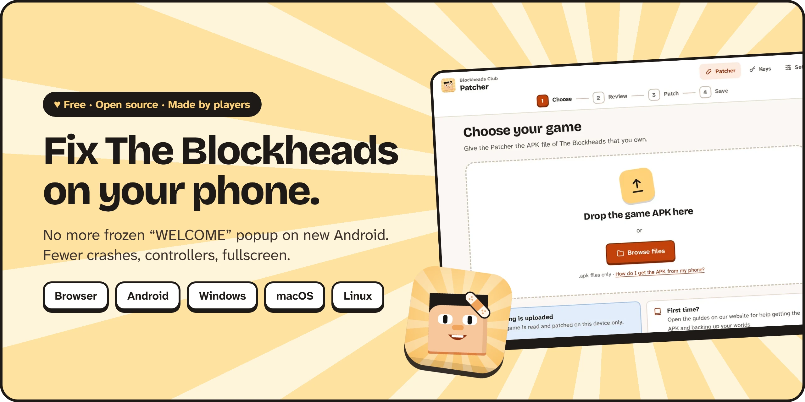
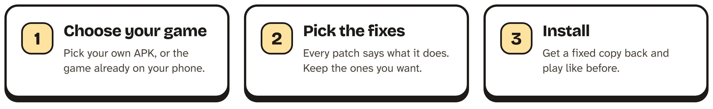
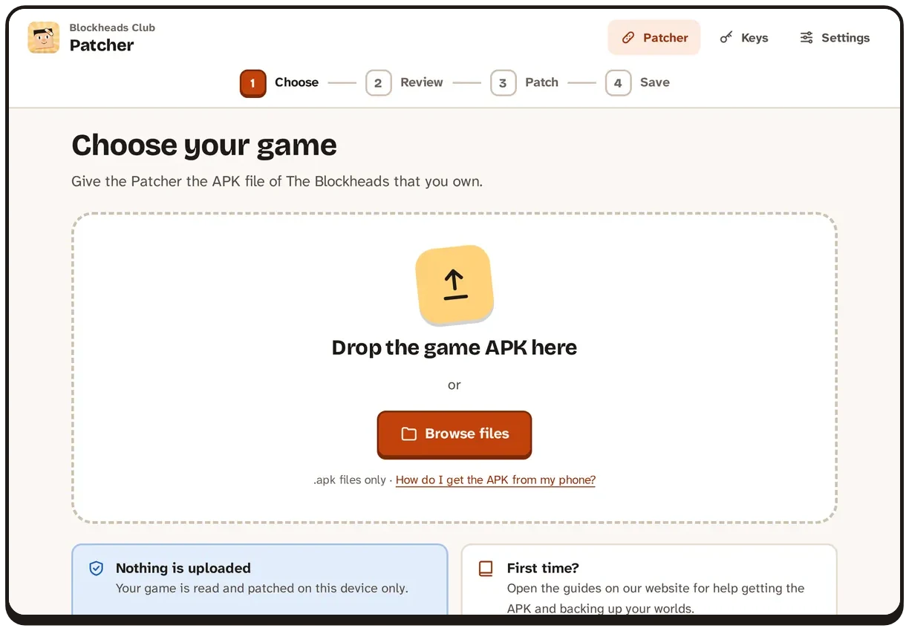
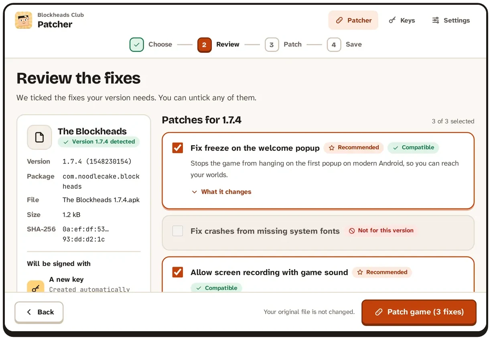
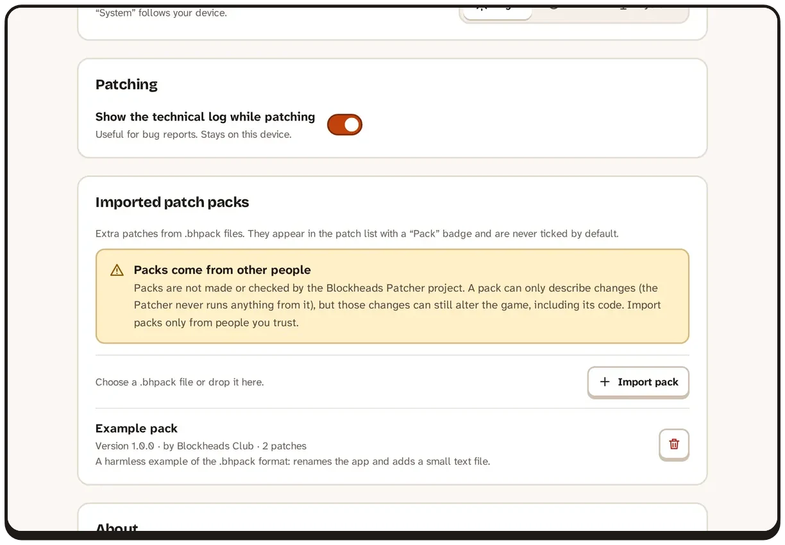
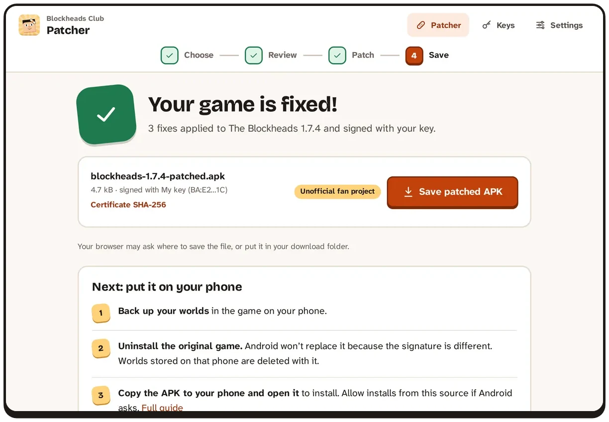
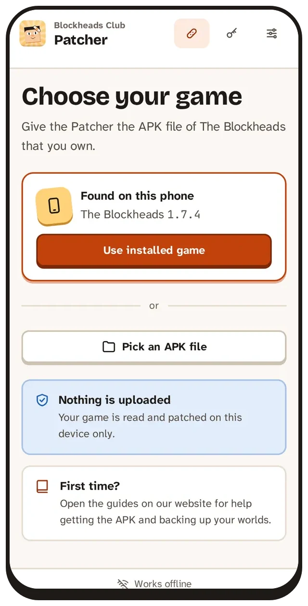
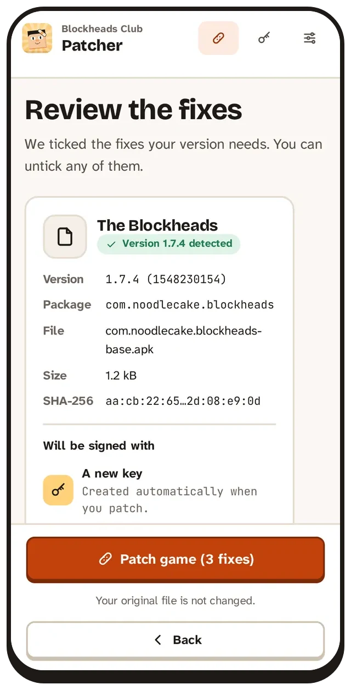
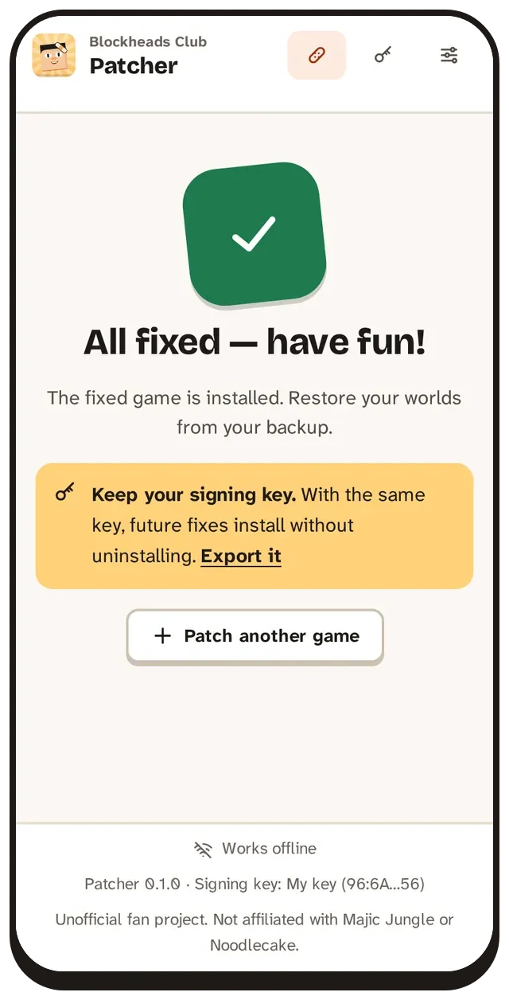

<p align="center">
  <a href="https://blockheads.club/patcher/">
    
  </a>
</p>

<p align="center">
  <a href="https://github.com/Blockheads-Club/blockheads-patcher/releases/latest"></a>
  <a href="https://github.com/Blockheads-Club/blockheads-patcher/releases"></a>
  <a href="https://github.com/Blockheads-Club/blockheads-patcher/stargazers"></a>
  <a href="LICENSE"></a>
</p>

<h3 align="center">
  <a href="https://blockheads.club/patcher/">🌐 Open in your browser</a>
  &nbsp;·&nbsp;
  <a href="https://github.com/Blockheads-Club/blockheads-patcher/releases/latest">⬇️ Download</a>
  &nbsp;·&nbsp;
  <a href="https://blockheads.club/docs/guides/fix-game-on-phone">📖 Step-by-step guide</a>
  &nbsp;·&nbsp;
  <a href="https://github.com/Blockheads-Club/blockheads-patcher/issues/new">🐞 Report a bug</a>
</h3>

<br>

Stuck on the **"WELCOME TO …!"** popup when you join a server on a new phone? Crashes in the store or in your worlds?
**Blockheads Patcher** takes **your own copy** of The Blockheads for Android and gives you back a fixed one. You
choose which fixes go in. Everything happens on your device: no game files are included or downloaded, and nothing
is uploaded.

> [!NOTE]
> **Alpha (v0.5.1 pre-release).** Usable, but try the patched game before you rely on it, and keep a backup of your
> worlds.

## ✨ What it fixes

<table>
  <tr>
    <td width="50%" valign="top">
      <h3>🧊 No more frozen popup</h3>
      The game no longer hangs on the welcome popup when you join a server on Android 10 and newer.
    </td>
    <td width="50%" valign="top">
      <h3>💥 Fewer crashes</h3>
      Missing system fonts, screen changes (folding, split screen, dark mode), crashing web pages: fixed.
    </td>
  </tr>
  <tr>
    <td valign="top">
      <h3>🎮 Controllers and fullscreen</h3>
      Play with a game controller, hide the status bars, fill foldables and tablets.
    </td>
    <td valign="top">
      <h3>🔗 Join links and LAN</h3>
      Wi-Fi worlds show up again and <code>blockheads://</code> join links open the game.
    </td>
  </tr>
  <tr>
    <td valign="top">
      <h3>🎵 Little things</h3>
      Music resumes after switching apps, lowercase letters on signs, an icon that matches your phone.
    </td>
    <td valign="top">
      <h3>🧩 Mod loader</h3>
      Install the Blockheads Club mod loader and join modded servers from your phone.
    </td>
  </tr>
</table>

Every patch explains what it changes, and you can turn each one off. The full list:
[blockheads.club/docs/patcher](https://blockheads.club/docs/patcher).

## 🚀 Fix your game in 3 steps

<p align="center"></p>

<p align="center">
  <a href="https://blockheads.club/patcher/"></a>
  <a href="https://github.com/Blockheads-Club/blockheads-patcher/releases/latest"></a>
  <a href="https://github.com/Blockheads-Club/blockheads-patcher/releases/latest"></a>
  <a href="https://github.com/Blockheads-Club/blockheads-patcher/releases/latest"></a>
  <a href="https://github.com/Blockheads-Club/blockheads-patcher/releases/latest"></a>
</p>

| Where | How |
| --- | --- |
| 🌐 **Browser** (easiest) | Open [blockheads.club/patcher](https://blockheads.club/patcher/), pick your game APK, choose fixes, download the result. |
| 📱 **Android** | Install the APK from the [latest release](https://github.com/Blockheads-Club/blockheads-patcher/releases/latest) (`android-arm64` for most phones). It patches the game already on your phone. |
| 💻 **Desktop** | Windows (`.exe` / `.msi`), macOS (`.dmg`) or Linux (`.AppImage` / `.deb`) from the [latest release](https://github.com/Blockheads-Club/blockheads-patcher/releases/latest). |

> [!IMPORTANT]
> The fixed game is signed with a new key, so Android asks you to uninstall the original first.
> **Back up your worlds before that:** [how to back up](https://blockheads.club/docs/guides/backup-worlds).

## 📸 Screenshots

<table>
  <tr>
    <td width="50%"></td>
    <td width="50%"></td>
  </tr>
  <tr>
    <td></td>
    <td></td>
  </tr>
</table>

<p align="center">
  
  &nbsp;
  
  &nbsp;
  
</p>

## ❓ Questions

<details>
<summary><b>Do I lose my worlds?</b></summary>
<br>
The original game has to be uninstalled first, and that removes its data. Back up your worlds before you install the
fixed game: <a href="https://blockheads.club/docs/guides/backup-worlds">back up your worlds</a>. The
<a href="https://github.com/Blockheads-Club/world-tool">World Tool</a> can do it for you over USB.
</details>

<details>
<summary><b>Where do I get the game APK?</b></summary>
<br>
From your own phone: <a href="https://blockheads.club/docs/guides/get-apk">get your APK</a>. The Android app of the
Patcher can also use the game that is already installed.
</details>

<details>
<summary><b>Can patched and original players play together?</b></summary>
<br>
Yes. The fixes don't change how the game talks to servers.
</details>

<details>
<summary><b>What is a signing key and why keep it?</b></summary>
<br>
The fixed game is signed with a key the Patcher makes for you. Keep it, and future updates install over your game
without another uninstall: <a href="https://blockheads.club/docs/guides/signing-key">about the signing key</a>.
</details>

<details>
<summary><b>Can I add my own patches?</b></summary>
<br>
Yes, as <code>.bhpack</code> files (Settings → Imported patch packs). Packs are data only; the Patcher never runs code
from them. Format: <a href="docs/patch-packs.md">docs/patch-packs.md</a>.
</details>

## 🧱 Part of Blockheads Club

<table>
  <tr>
    <td align="center" width="25%"><a href="https://github.com/Blockheads-Club/blockheads-pc"><br><b>Blockheads PC</b></a><br><sub>Play on your computer</sub></td>
    <td align="center" width="25%"><a href="https://github.com/Blockheads-Club/blockheads-server"><br><b>Server</b></a><br><sub>Host worlds for friends</sub></td>
    <td align="center" width="25%"><a href="https://github.com/Blockheads-Club/world-tool"><br><b>World Tool</b></a><br><sub>Move and edit your worlds</sub></td>
    <td align="center" width="25%"><a href="https://github.com/Blockheads-Club/mod-sdk"><br><b>Mod SDK</b></a><br><sub>Make your own mods</sub></td>
  </tr>
</table>

<p align="center">All apps, guides and downloads: <a href="https://blockheads.club"><b>blockheads.club</b></a></p>

## 🛠️ For developers

<details>
<summary><b>Build from source</b></summary>
<br>

You need [bun](https://bun.sh) and Rust stable. For the Android app also the Android SDK, NDK 27 and JDK 17 or 21.

```bash
git clone https://github.com/Blockheads-Club/blockheads-patcher.git
cd blockheads-patcher
bun install
bun run dev        # web app on http://localhost:1420
bun run test:cov   # the gate: every test, 100% coverage
```

More: [docs/development.md](docs/development.md) (desktop and Android builds, tests, deploy, releases, CI) and
[docs/ARCHITECTURE.md](docs/ARCHITECTURE.md) (module contracts).
</details>

Everyone can open [issues](https://github.com/Blockheads-Club/blockheads-patcher/issues) and pull requests. Irrelevant
or abusive issues may be closed or removed.

### Credits

Bug list and ideas from [JarlPenguin/blockheads-android-patches](https://github.com/JarlPenguin/blockheads-android-patches);
every fix was written independently by Blockheads Club from our own analysis of the game
([details](docs/cleanroom/jarlpenguin-triage.md)). Credited patches show this in the app.

## 📄 License

Blockheads Patcher is free software under the **GNU GPLv3 or later** (GPL-3.0-or-later): you can redistribute it
and/or modify it under the terms of the GNU General Public License as published by the Free Software Foundation,
either version 3 of the License, or (at your option) any later version. See [LICENSE](LICENSE).
Bundled Noto Sans font subsets are under the SIL Open Font License 1.1.

Unofficial fan project, not affiliated with Majic Jungle Games or Noodlecake Studios. Only patch software you legally
own.
